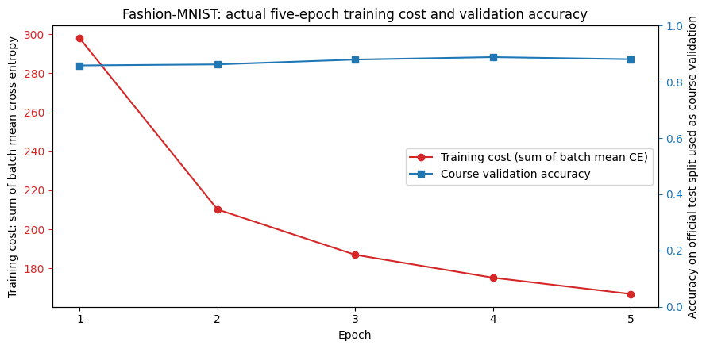
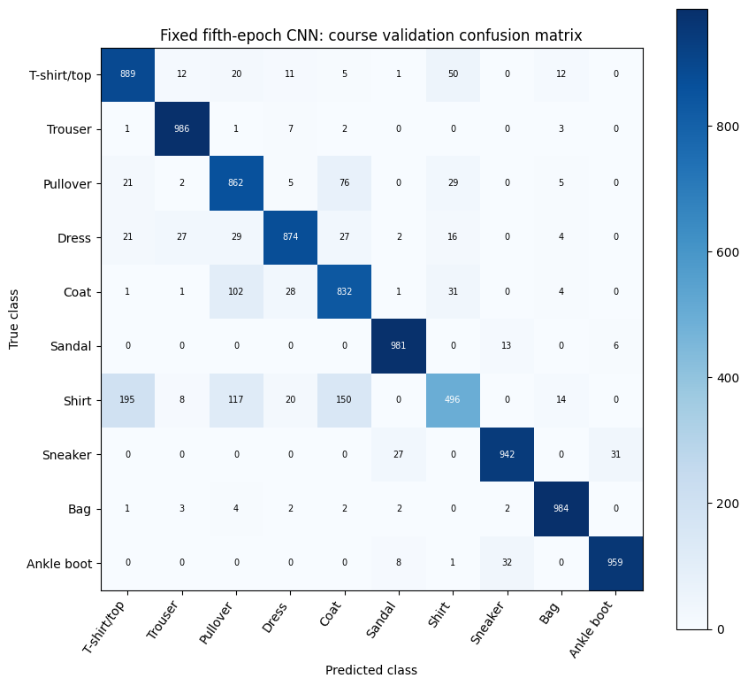

# Fashion-MNIST Classification with PyTorch

AI-assisted educational project based on the IBM/Coursera Fashion-MNIST notebook. The source tasks and CNN constructors are credited to IBM; AI assistance is disclosed in the executed notebook. This repository records a real training run and does not claim independent authorship, a course grade, certification, or production readiness.

## Recorded results

| Item | Verified result |
| --- | --- |
| Training data | All 60,000 Fashion-MNIST training images |
| Course validation data | All 10,000 images in the official test split |
| Input transform | Resize from 28×28 to 16×16, then `ToTensor()` |
| Model | Two convolution layers, BatchNorm, ReLU, max pooling and a 512→10 classifier |
| Training | SGD, learning rate 0.1, batch size 100, seed 0, 5 epochs |
| Final validation accuracy | **88.05% — 8,805 / 10,000** |
| Macro F1 | 0.8763 |
| Majority-class baseline | 10% |
| Saved-model reload | All 10,000 predictions matched; maximum logit difference 0 |
| Notebook execution | 16 code cells executed in order; zero error outputs |

The fixed fifth-epoch result is reported. Validation accuracy at epoch four was 88.81%; it was not substituted for the final result. The official test split was reused as course validation each epoch, so it is not an untouched final test. The lowest class recall was `Shirt` at 49.6%. No performance on customer photographs is established.

## Project files

- [Executed notebook](Fashion_MNIST_Completed.ipynb): complete code, outputs, original attribution, AI disclosure and limitations.
- [Raw metrics](results/execution_metrics.json): epoch history, class metrics, confusion matrix, dataset checksums and reload checks.
- [Notebook runner](execute_fashion_project.py): re-executes the notebook in a Python Jupyter kernel.
- [Validation samples](figures/validation_samples.png), [training curves](figures/training_cost_and_accuracy.png), and [confusion matrix](figures/confusion_matrix.png): extracted from the actual notebook outputs.





## Run locally

The recorded run used Python 3.10.11, PyTorch 2.8.0+cpu, TorchVision 0.23.0+cpu, NumPy 1.26.4, Matplotlib 3.10.9 and Pillow 12.3.0. Use an isolated environment:

```bash
python3 -m venv .venv
# Linux / macOS
source .venv/bin/activate
# Windows PowerShell: .venv\Scripts\Activate.ps1
python -m pip install --upgrade pip
python -m pip install torch==2.8.0+cpu torchvision==0.23.0+cpu --index-url https://download.pytorch.org/whl/cpu
python -m pip install -r requirements.txt
python -m ipykernel install --sys-prefix --name python3 --display-name "Fashion-MNIST Python"
python execute_fashion_project.py
```

The rerun command updates the notebook outputs and writes generated files under `fashion_outputs/`. It downloads the official Fashion-MNIST archives on the first run and validates the published MD5 checksums. Dataset files, local environments and regenerated model weights are not committed. Training time depends on hardware; the recorded CPU run took about 158 seconds for training and per-epoch validation, excluding downloads and the final audit. Reproduction on another environment may differ numerically.

## Attribution

- Original project notebook and CNN constructors: IBM / Coursera, *Deep Learning with PyTorch*, Fashion-MNIST Classification. Original copyright notices and author credits remain in the notebook.
- Dataset: [Fashion-MNIST by Zalando Research](https://github.com/zalandoresearch/fashion-mnist).
- Framework: [PyTorch](https://pytorch.org/) and [TorchVision](https://pytorch.org/vision/).

AI-assisted changes include task completion, reproducible execution, integrity and reload checks, plots and documentation. Third-party code and data retain their respective terms; no blanket license is asserted over the IBM materials.
